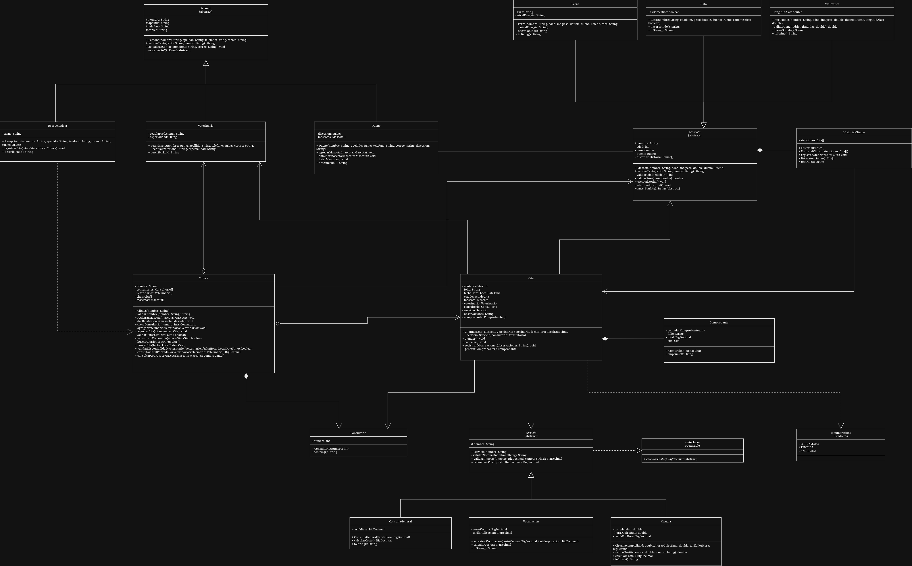

# PetCare — Sistema de Gestión Veterinaria

Aplicación de consola desarrollada en Java para gestionar las operaciones básicas de una clínica veterinaria: registro de dueños y mascotas, administración de veterinarios, programación y atención de citas, historial clínico y cálculo de cobros por servicios.

Este proyecto aplica los principios de **Diseño y Programación Orientada a Objetos (POO)** mediante un modelo de clases documentado con UML.

## Tecnologías utilizadas

| Herramienta | Uso |
|---|---|
| Java 17 | Implementación de la aplicación |
| IntelliJ IDEA | Entorno de desarrollo |
| Draw.io | Diseño de diagramas UML |
| Git y GitHub | Control de versiones y publicación |

## Modelo de la solución

El modelo contempla personas (dueños, veterinarios y recepcionistas), mascotas (perros, gatos y aves exóticas), una clínica con consultorios, citas, servicios y comprobantes de cobro.

**Diagrama de clases:** [Abrir diagrama](docs/diagramas/PetCare_UML_Clases.drawio).



### Relaciones y decisiones de diseño

- **Herencia:** Dueno, Recepcionista y Veterinario comparten los datos de Persona; Perro, Gato y AveExotica comparten los de Mascota. Cada hija implementa su comportamiento particular.
- **Interfaz:** Facturable define `calcularCosto()`. ConsultaGeneral, Vacunacion y Cirugia aplican distintas fórmulas bajo el mismo contrato.
- **Asociación:** una cita conecta una mascota, un veterinario, un consultorio y un servicio que existen como objetos independientes.
- **Agregación:** la clínica incorpora veterinarios ya creados; estos pueden existir independientemente de ella.
- **Composición:** la clínica crea sus consultorios, la mascota crea su historial y la cita genera su comprobante. Cada parte pertenece al objeto que la administra.
- **Importes:** se usa `BigDecimal` para conservar la precisión decimal; los costos finales se redondean a dos decimales con `HALF_UP`.

La tabla de clases, los objetos de ejemplo y la justificación de cada relación están en [docs/analisis.md](docs/analisis.md).

## Estructura del proyecto

Estructura prevista, sujeta a ajustes conforme avance la implementación:

```text
petcare-poo-java/
├── README.md
├── .gitignore
├── docs/
│   ├── analisis.md
│   ├── evidencia_ejecucion.md
│   ├── diagramas/
│   └── capturas/
└── src/
    ├── app/
    │   └── Main.java
    └── modelo/
        ├── personas/
        ├── mascotas/
        ├── clinica/
        ├── servicios/
        └── cobros/
```

El paquete indicado como `cobros` en la estructura prevista se implementó como `modelo.comprobante`.

| Paquete | Responsabilidad |
|---|---|
| `app` | Menú, lectura de datos y presentación de resultados. |
| `modelo.personas` | Dueños, veterinarios y recepcionistas. |
| `modelo.mascotas` | Datos, validaciones y sonidos de las mascotas. |
| `modelo.clinica` | Agenda, consultorios, registros e historial clínico. |
| `modelo.servicios` | Contrato facturable y cálculo de costos. |
| `modelo.comprobante` | Emisión y conservación del importe cobrado. |

## Conceptos de POO aplicados

Las líneas corresponden a la implementación actual.

| Concepto | Archivo y línea | Aplicación |
|---|---|---|
| Herencia | [Perro.java:8](src/modelo/mascotas/Perro.java#L8) | Perro extiende Mascota. |
| Clase abstracta | [Mascota.java:12](src/modelo/mascotas/Mascota.java#L12) | Define datos comunes y el contrato de sonido. |
| Interfaz | [Facturable.java:14](src/modelo/servicios/Facturable.java#L14) | Establece `calcularCosto()`. |
| Polimorfismo | [Main.java:300](src/app/Main.java#L300), [Main.java:327](src/app/Main.java#L327) | Recorre mascotas y servicios mediante tipos comunes. |
| Encapsulamiento | [Mascota.java:78](src/modelo/mascotas/Mascota.java#L78) | Modifica la edad mediante validación. |
| Constructores y sobrecarga | [HistorialClinico.java:16](src/modelo/clinica/HistorialClinico.java#L16), [Clinica.java:253](src/modelo/clinica/Clinica.java#L253) | Constructores sin argumentos y con lista; búsquedas por folio y fecha. |
| Sobreescritura | [Perro.java:65](src/modelo/mascotas/Perro.java#L65) | Implementa el sonido de su especie. |
| Asociación | [Cita.java:24](src/modelo/clinica/Cita.java#L24) | Conserva referencias a los participantes de la atención. |
| Agregación | [Clinica.java:174](src/modelo/clinica/Clinica.java#L174) | Recibe veterinarios existentes. |
| Composición | [Clinica.java:154](src/modelo/clinica/Clinica.java#L154), [Mascota.java:38](src/modelo/mascotas/Mascota.java#L38) | Crea consultorios e historial dentro de sus contenedores. |
| Miembros `static` | [Comprobante.java:17](src/modelo/comprobante/Comprobante.java#L17) | Comparte el contador de folios entre comprobantes. |
| Acceso de paquete | [Consultorio.java:16](src/modelo/clinica/Consultorio.java#L16) | Restringe la construcción al paquete de la clínica. |
| Baja de objetos | [Clinica.java:128](src/modelo/clinica/Clinica.java#L128) | Retira la mascota del registro activo y su historial; conserva cobros anteriores. |

## Reglas de negocio

1. El peso y la edad de una mascota deben ser mayores que cero.
2. Un veterinario no puede tener dos citas programadas a la misma hora.
3. Una cita cancelada no puede marcarse como atendida.
4. Un consultorio no puede asignarse a dos citas simultáneas.
5. Los costos no pueden ser negativos.
6. Los cobros deben poder consultarse por mascota y por veterinario.

## Instalación y ejecución

Requisitos: Git y un **JDK 17 o superior**. Desde una terminal Bash (Linux, macOS o Git Bash):

```bash
git clone https://github.com/Emiliano-LIS/petcare-poo-java.git
cd petcare-poo-java
mkdir -p out
javac --release 17 -encoding UTF-8 -d out $(find src -name '*.java')
java -cp out app.Main
```

La clínica inicia con dos consultorios. 
Registra dueños, mascotas y veterinarios desde el menú; después agenda las citas.

## Ejemplo de uso

La [evidencia completa](docs/evidencia_ejecucion.md) registra dos dueños, tres mascotas (Felix, Hugo y Bamir), dos veterinarios, tres citas y dos atenciones. Incluye los sonidos, un conflicto de horario y la consulta del historial. Extracto de resultados:

```text
Dueño registrado: Joaquin Gimenez
Dueño registrado: Hephaethir Rhinedot
Costo de Consulta general: $300.00
Costo de Vacunación: $150.00
Costo de Cirugía: $150.00
Citas registradas: 3
El veterinario no esta disponible en este horario
Perro | Nombre: Felix | Edad: 1 | Peso: 20.0 | Dueño: Joaquin Gimenez | Raza: Pastor aleman | Nivel de energía: 5 | Sonido: Guau
Gato | Nombre: Hugo | Edad: 5 | Peso: 3.0 | Dueño: Joaquin Gimenez | Doméstico: Sí | Sonido: Miau
Ave exótica | Nombre: Bamir | Edad: 2 | Peso: 4.0 | Dueño: Hephaethir Rhinedot | Longitud de alas: 0.7 | Sonido: Pío
Estado de CITA-1: ATENDIDA
Estado de CITA-2: ATENDIDA
Estado de CITA-3: CANCELADA
==== Historial clínico de Felix ====
CITA-1 | Fecha: 2026-11-14 12:00 | Estado: Atendida | Mascota: Felix | Veterinario: Jimena Rodriguez Marcial | Consultorio: 1 | Servicio: Consulta general | Observaciones: Ninguna | Comprobante: COMP-1
Horacio Jimenez: 0
Jimena Rodriguez Marcial: 300.00
Total cobrado: 300.00
```

En ese escenario solo se emite `COMP-1`, por $300.00. Atender una cita y emitir su comprobante son opciones distintas; el costo calculado de un servicio no se contabiliza como cobro hasta emitirlo. Las capturas están en [docs/capturas](docs/capturas/).

## Reflexión personal

**¿Qué aprendí?**
Diría que aprendí un poco más de como se trabaja en Java con IntelliJ; es una experiencia muy diferente a lo que había hecho antes, se nota que es un IDE dedicado por las sugerencias que hace, muy coherentes a lo que se hace, es practicamente como un ayudante

**¿Qué fue lo más difícil?** 
Lo más dificil fue hacer las validaciones correctamente, tuve muchos problemas con detalles que se me escaparon por todos lados, revisando con la IA me di cuenta de muchos errores, tanto en documentación como en código.

**¿Qué mejoraría?** Pendiente.
Principalmente necesito mejorar mi diccionario de código; Conozco poco o nada del lenguaje y hay artimañas (Por decirlo así) que se pueden utilizar, hay varias cosas que
son generales de los lenguajes de programación pero puedes no acordarte, y eso lo hace divertido, cuando tienes a la IA te puede dar un enfoque y decir "Ohhh" y mejorar la calidad del código
especialmente cuando se trata de validaciones

**Uso de inteligencia artificial (si aplica):** 
La IA fue altamente usada para este proyecto, pero mi postura es la siguiente:
la IA como tal no es mala; por si sola no hace ningún tipo de daño, al final es una herramienta desarrollada con el proposito de ayudar al mano; bien dicho esto
use la IA principalmente para solucionar problemas de maneras que sentí que eran posibles pero no sabía como implementarlas, dando una guia, también
fue usada para resolver algunos problemas que me atascaron, principalmente a la hora de la documentación; el código fue sencillo relativamente a excepción de las validaciones.
El problema ocurrio a la hora de reutilizar código en el main; considero que allí fue donde más IA use dado que: Al principio hice un main lleno de código pero sentí que se podía achicar
La IA me dio una solución ingeniosa a esto: usar <T> que es un tipo generico, eso me salvo dado que podía reutilizar un mismo seleccionador para varias clases, Mascota, Persona, Veterinario, etc.
Otra cosa que también me apoye de la IA es en la documentación, esto con el propósito de ver otra postura; También me ayudo a los formatos, suele ser tardado dar formatos de h1, h2, listas y tablas así que la IA resulta muy útil una vez dada la idea correcta
Y por último la IA fue usada para generar la mayoría de los comentarios, considero que algunas cosas se explican por si mismas, si es un get es evidente que es para obtener la información, por lo que relege esta tarea repetitiva a la IA
Hubo código que me costo un poco entender la implementación que sugeria por lo que decidí dividirlos por pasos usando comentarios que deje. No son notas, son funcionamiento.
Oh, y también la IA se uso para testear, esto si es algo que hago mucho, uso la IA para probar una y otra vez si el código: compila, funciona, reacciona, cumple los requerimientos y/o se apega a lo dicho

## Autor

**Nombre:** Jorge Emiliano Hernandez Martinez.

**Perfil de GitHub:** EmilianoLIS.
