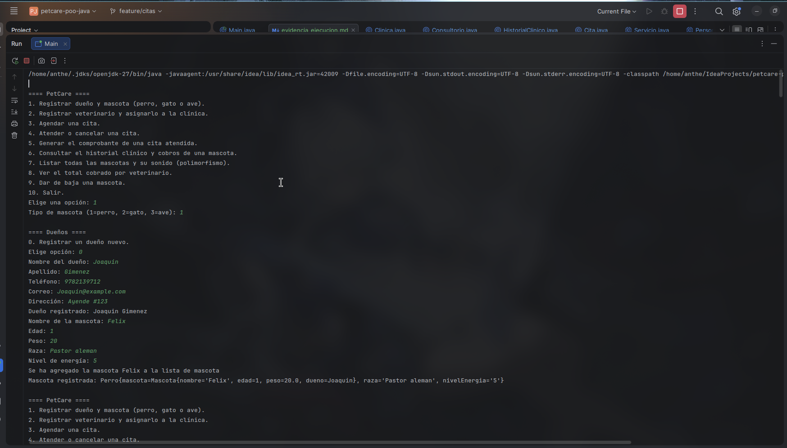
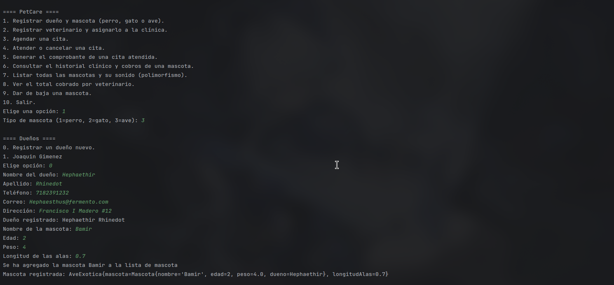

# Evidencia de ejecución — PetCare

La secuencia original se repitió con los mismos datos para actualizar las salidas al nuevo formato de `toString()`: una sola línea, etiquetas claras y campos separados por ` | `.

Los bloques muestran entradas y resultados de consola. Se omiten las repeticiones del menú y algunos listados de selección para facilitar la lectura. Las capturas originales se conservan al final del documento.

## Resumen del escenario

| Elemento | Resultado |
|---|---|
| Dueños | Joaquin Gimenez y Hephaethir Rhinedot |
| Mascotas | Felix (perro), Hugo (gato) y Bamir (ave exótica) |
| Veterinarios | Horacio Jimenez y Jimena Rodriguez Marcial |
| Citas registradas | 3; el cuarto intento se rechaza por conflicto de horario |
| Atenciones | 2 |
| Cancelaciones | 1 |
| Comprobantes emitidos | 1, por $300.00 |

| Folio | Mascota | Servicio | Costo calculado | Estado final | Comprobante |
|---|---|---|---:|---|---|
| CITA-1 | Felix | Consulta general | $300.00 | Atendida | COMP-1 |
| CITA-2 | Hugo | Vacunación | $150.00 | Atendida | Sin emitir |
| CITA-3 | Bamir | Cirugía | $150.00 | Cancelada | Sin emitir |

```text
==== PetCare ====
1. Registrar dueño y mascota (perro, gato o ave).
2. Registrar veterinario y asignarlo a la clínica.
3. Agendar una cita.
4. Atender o cancelar una cita.
5. Generar el comprobante de una cita atendida.
6. Consultar el historial clínico y cobros de una mascota.
7. Listar todas las mascotas y su sonido (polimorfismo).
8. Ver el total cobrado por veterinario.
9. Dar de baja una mascota.
10. Salir.

Elige una opción: 1
Tipo de mascota (1=perro, 2=gato, 3=ave): 1

==== Dueños ====
0. Registrar un dueño nuevo.
Elige opción: 0
Nombre del dueño: Joaquin
Apellido: Gimenez
Teléfono: 9782139712
Correo: Joaquin@example.com
Dirección: Ayende #123
Dueño registrado: Joaquin Gimenez
Nombre de la mascota: Felix
Edad: 1
Peso: 20
Raza: Pastor aleman
Nivel de energía: 5
Se ha agregado la mascota Felix a la lista de mascota
Mascota registrada: Perro | Nombre: Felix | Edad: 1 | Peso: 20.0 | Dueño: Joaquin Gimenez | Raza: Pastor aleman | Nivel de energía: 5

Elige una opción: 1
Tipo de mascota (1=perro, 2=gato, 3=ave): 2

==== Dueños ====
0. Registrar un dueño nuevo.
1. Joaquin Gimenez
Elige opción: 1
Nombre de la mascota: Hugo
Edad: 5
Peso: 3
¿Es doméstico? (1=sí, 2=no): 1
Se ha agregado la mascota Hugo a la lista de mascota
Mascota registrada: Gato | Nombre: Hugo | Edad: 5 | Peso: 3.0 | Dueño: Joaquin Gimenez | Doméstico: Sí

Elige una opción: 1
Tipo de mascota (1=perro, 2=gato, 3=ave): 3

==== Dueños ====
0. Registrar un dueño nuevo.
1. Joaquin Gimenez
Elige opción: 0
Nombre del dueño: Hephaethir
Apellido: Rhinedot
Teléfono: 7182391232
Correo: Hephaesthus@fermento.com
Dirección: Francisco I Madero #12
Dueño registrado: Hephaethir Rhinedot
Nombre de la mascota: Bamir
Edad: 2
Peso: 4
Longitud de las alas: 0.7
Se ha agregado la mascota Bamir a la lista de mascota
Mascota registrada: Ave exótica | Nombre: Bamir | Edad: 2 | Peso: 4.0 | Dueño: Hephaethir Rhinedot | Longitud de alas: 0.7

Elige una opción: 2
Nombre del veterinario: Horacio
Apellido: Jimenez
Teléfono: 917238912
Correo: Jimenez@example.com
Cédula profesional: DEHUIKS01LA
Especialidad: Medico veterinario cirujano
Registro agregado correctamente

Elige una opción: 2
Nombre del veterinario: Jimena
Apellido: Rodriguez Marcial
Teléfono: 192783912
Correo: Marcial@example.com
Cédula profesional: JASNDMD891UA
Especialidad: Médico veterinario
Registro agregado correctamente

Elige una opción: 3

==== Mascotas ====
1. Perro | Nombre: Felix | Edad: 1 | Peso: 20.0 | Dueño: Joaquin Gimenez | Raza: Pastor aleman | Nivel de energía: 5
2. Gato | Nombre: Hugo | Edad: 5 | Peso: 3.0 | Dueño: Joaquin Gimenez | Doméstico: Sí
3. Ave exótica | Nombre: Bamir | Edad: 2 | Peso: 4.0 | Dueño: Hephaethir Rhinedot | Longitud de alas: 0.7
Elige opción: 1

==== Veterinarios ====
1. Veterinario | Nombre: Horacio Jimenez | Teléfono: 917238912 | Correo: Jimenez@example.com | Cédula profesional: DEHUIKS01LA | Especialidad: Medico veterinario cirujano
2. Veterinario | Nombre: Jimena Rodriguez Marcial | Teléfono: 192783912 | Correo: Marcial@example.com | Cédula profesional: JASNDMD891UA | Especialidad: Médico veterinario
Elige opción: 2

==== Consultorios ====
1. Consultorio 1
2. Consultorio 2
Elige opción: 1
Fecha y hora (AAAA-MM-DD HH:MM): 2026-11-14 12:00
Servicio (1=consulta, 2=vacunación, 3=cirugía): 1
Tarifa de consulta: 300
Cita agendada: CITA-1
Costo de Consulta general: $300.00
Citas registradas: 1

Fecha y hora (AAAA-MM-DD HH:MM): 2026-11-13 02:00
Servicio (1=consulta, 2=vacunación, 3=cirugía): 2
Costo de la vacuna: 50
Tarifa de aplicación: 100
Cita agendada: CITA-2
Costo de Vacunación: $150.00
Citas registradas: 2

Fecha y hora (AAAA-MM-DD HH:MM): 2026-11-14 02:00
Servicio (1=consulta, 2=vacunación, 3=cirugía): 3
Factor de complejidad (1=base, 1.5=+50%): 1.5
Horas de quirófano: 2
Tarifa por hora: 50
Cita agendada: CITA-3
Costo de Cirugía: $150.00
Citas registradas: 3

Fecha y hora (AAAA-MM-DD HH:MM): 2026-11-14 12:00
Servicio (1=consulta, 2=vacunación, 3=cirugía): 1
Tarifa de consulta: 100
El veterinario no esta disponible en este horario


Elige una opción: 7
Perro | Nombre: Felix | Edad: 1 | Peso: 20.0 | Dueño: Joaquin Gimenez | Raza: Pastor aleman | Nivel de energía: 5 | Sonido: Guau
Gato | Nombre: Hugo | Edad: 5 | Peso: 3.0 | Dueño: Joaquin Gimenez | Doméstico: Sí | Sonido: Miau
Ave exótica | Nombre: Bamir | Edad: 2 | Peso: 4.0 | Dueño: Hephaethir Rhinedot | Longitud de alas: 0.7 | Sonido: Pío

==== Historial clínico de Felix ====
No hay atenciones registradas.

==== Comprobantes de Felix ====
No hay cobros registrados.

Folio de la cita: 1
No se encontraron coincidencias.

Folio de la cita: CITA-1
CITA-1 | Fecha: 2026-11-14 12:00 | Estado: Programada | Mascota: Felix | Veterinario: Jimena Rodriguez Marcial | Consultorio: 1 | Servicio: Consulta general | Observaciones: Sin observaciones | Comprobante: Sin emitir
Acción (1=atender, 2=cancelar): 1
Observaciones de la atención: 
El dato no puede estar vacío.
Observaciones de la atención: Ninguna
Estado de CITA-1: ATENDIDA 

Folio de la cita: CITA-2
CITA-2 | Fecha: 2026-11-13 02:00 | Estado: Programada | Mascota: Hugo | Veterinario: Horacio Jimenez | Consultorio: 2 | Servicio: Vacunación | Observaciones: Sin observaciones | Comprobante: Sin emitir
Acción (1=atender, 2=cancelar): 1
Observaciones de la atención: Ninguna
Estado de CITA-2: ATENDIDA

Folio de la cita: CITA-3
CITA-3 | Fecha: 2026-11-14 02:00 | Estado: Programada | Mascota: Bamir | Veterinario: Horacio Jimenez | Consultorio: 2 | Servicio: Cirugía | Observaciones: Sin observaciones | Comprobante: Sin emitir
Acción (1=atender, 2=cancelar): 2
Estado de CITA-3: CANCELADA

==== Historial clínico de Felix ====
CITA-1 | Fecha: 2026-11-14 12:00 | Estado: Atendida | Mascota: Felix | Veterinario: Jimena Rodriguez Marcial | Consultorio: 1 | Servicio: Consulta general | Observaciones: Ninguna | Comprobante: Sin emitir

==== Comprobantes de Felix ====
No hay cobros registrados.

Folio de la cita: CITA-1
CITA-1 | Fecha: 2026-11-14 12:00 | Estado: Atendida | Mascota: Felix | Veterinario: Jimena Rodriguez Marcial | Consultorio: 1 | Servicio: Consulta general | Observaciones: Ninguna | Comprobante: Sin emitir
=== Comprobante de cobro ===
Folio: COMP-1
Cita: CITA-1
Total: 300.00

==== Historial clínico de Felix ====
CITA-1 | Fecha: 2026-11-14 12:00 | Estado: Atendida | Mascota: Felix | Veterinario: Jimena Rodriguez Marcial | Consultorio: 1 | Servicio: Consulta general | Observaciones: Ninguna | Comprobante: COMP-1

==== Comprobantes de Felix ====
=== Comprobante de cobro ===
Folio: COMP-1
Cita: CITA-1
Total: 300.00

==== PetCare ====
1. Registrar dueño y mascota (perro, gato o ave).
2. Registrar veterinario y asignarlo a la clínica.
3. Agendar una cita.
4. Atender o cancelar una cita.
5. Generar el comprobante de una cita atendida.
6. Consultar el historial clínico y cobros de una mascota.
7. Listar todas las mascotas y su sonido (polimorfismo).
8. Ver el total cobrado por veterinario.
9. Dar de baja una mascota.
10. Salir.
Elige una opción: 8

==== Total cobrado por veterinario ====
Horacio Jimenez: 0
Jimena Rodriguez Marcial: 300.00
Total cobrado: 300.00
Costo calculado de servicios no cancelados: 450.00
Este cálculo incluye citas pendientes; no es el total cobrado.
```

## 12. Capturas de pantalla

Las imagenes corresponden a la ejecución principal, este ejercicio de acuerdo a las indicaciones establecidas en el documento.
### Captura 1



### Captura 2


